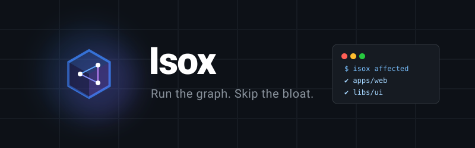

<div align="center">
  

  <br />
  <p><b>A lightweight monorepo command runner with explicit project configuration.</b></p>

[](https://opensource.org/licenses/MIT)
[](https://isox.sh)
</div>

## What is Isox?

Isox helps you work across multiple projects in one repository. Run a single
project or only what changed, reuse previous results, and distribute work across
GitHub Actions.

Bring your existing tools, with built-in support for TypeScript, ESLint, Vitest,
and release versioning.

## Get started

Requires Node.js 24+.

```sh
npm install --save-dev isox
npx isox init
```

Follow the [getting started guide](website/docs/getting-started.md) to set up your
first project. Then run commands like:

```sh
npx isox build my-app
npx isox test my-app
npx isox lint my-app
```

## Learn more

- [Documentation](https://isox.sh/docs/introduction) — setup, guides, and reference
- [Roadmap](ROADMAP.md) — what we're building next
- [Contributing](website/docs/contributing.mdx) — help improve Isox
- [Issues](https://github.com/isox-sh/isox/issues) — report bugs or suggest ideas

[MIT licensed](LICENSE).
